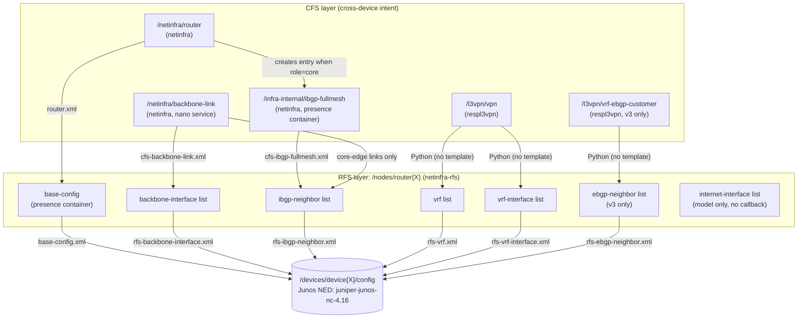
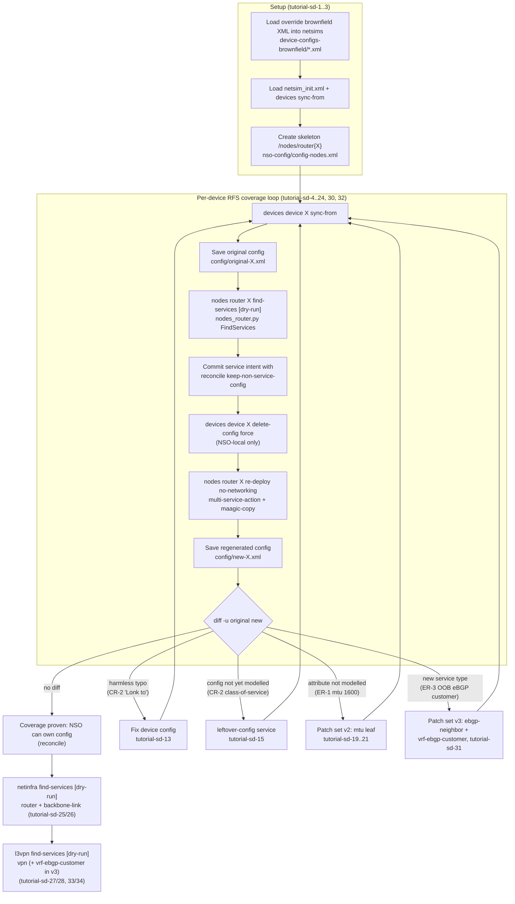

# Architecture overview

This document explains how the service-discovery framework in this repository
fits together: which NSO constructs it uses, how data flows from brownfield
device configuration to NSO service intent, and how the packages evolve across
the tutorial (v1 → v2 → v3).

Related documents:

- [Package reference](package-reference.md)
- [End-to-end walkthrough](walkthrough.md)
- [Limitations and assumptions](limitations.md)
- [Provisioning models](provisioning-models.md): why discovery is the step from
  imperative CLI config to declarative NSO services, and what intent-based adds

## The idea in one paragraph

NSO already holds a copy of each device's configuration in
`/devices/device{X}/config` (after `sync-from`). Discovery code (`find-services`
actions) walks that tree **bottom-up**, recognises configuration fragments that
match a reference service design, and writes the equivalent service *intent*
(`/nodes/router{X}/...`). To prove the intent is complete and does not alter
the network, the device's config is deleted locally, the services are
re-deployed with `no-networking`, and the regenerated config is diffed against
the original. Gaps are closed by (a) fixing harmless config on the device, (b)
temporarily covering it with a throw-away `leftover-config` service, or (c)
evolving the service model and discovery code (patch sets v2 and v3). When the
diff is empty, NSO can take ownership (reconcile).

## Service layering

The framework uses a two-tier **stacked service** design. Every RFS touches
exactly one device, and every RFS for a device is grouped under a single
`/nodes/router{name}` list entry (the "bundle device services" pattern). CFS
services sit above and write into `/nodes/router` rather than to devices.

`/netinfra/router` also allocates resources through the Resource Manager 5
`Allocator` API (router ID from `router-id`, IPv4 loopback from `ipv4-loopback`), and
`/netinfra/backbone-link` allocates link prefixes from `ipv4-backbone-link`
and `ipv6-backbone-link`. Pools are defined in
[`nso-config/config-resource-pools.xml`](../../nso-config/config-resource-pools.xml).

## Discovery pipeline

The pipeline has three phases: environment setup, a per-device RFS loop, and
CFS discovery on top of the discovered RFS intent. The loop is the "coverage
and diff check" described in [`tutorial.mk`](../../tutorial.mk).

### What each stage does

| Stage | Mechanism | Where |
| --- | --- | --- |
| sync-from | Standard NSO `devices device X sync-from`; makes the CDB copy of the device the source of truth for discovery. | `tutorial.mk` |
| Save original | `show configuration devices device X config \| display xml \| save config/original-X.xml` | `tutorial.mk` |
| Service model design | Reference ("ideal") RFS models per device, grouped under `/nodes/router`. | `packages/netinfra-rfs/src/yang/` |
| RFS discovery | `find-services` action on each `/nodes/router{X}` walks `/devices/device{X}/config/junos:configuration` using textual markers (interface descriptions, BGP group names, RD/RT IDs). | `packages/netinfra-rfs/python/netinfra_rfs/nodes_router.py` |
| Commit with reconcile | The action commits its write transaction with `reconcile keep-non-service-config` (or `discard-non-service-config`), or with `dry-run` (CLI format) to preview. New services take ownership of matching pre-existing device config. | same file, `FindServices.cb_action` |
| delete-config | `devices device X delete-config force` removes the device config in NSO only. Upstream added `force` for NSO 6.6 (`c1dc36a`). | `tutorial.mk` |
| Re-deploy no-networking | `nodes router X re-deploy no-networking` is **not** the built-in service action; it is the `multi-service-action` grouping, which re-deploys every service under the router entry (presence containers and list entries) in parallel threads and copies results back with `maagic-copy`. | `packages/multi-service-action`, `packages/maagic-copy` |
| Save new + diff | Regenerated config saved and `diff -u` against original. `-` lines are not covered; `+` lines are config the services would add (a service bug for discovery purposes). | `tutorial.mk` |
| leftover-config | A temporary service that emits the uncovered config so it drops out of the diff. Linked into `ncs-run/packages` only when needed. | `patches/leftover-config` |
| CFS discovery | `netinfra find-services` and `l3vpn find-services` read the **discovered RFS intent** under `/nodes/router` (not device config) and create CFS instances. | `packages/netinfra/python/netinfra/router.py`, `packages/respl3vpn/python/respl3vpn/l3vpn.py` |
| Reconcile / ownership | Implicit in the find-services commit; the tutorial does not run a separate `re-deploy reconcile` step. | — |

## Patch evolution: v1 → v2 → v3

The packages in `packages/` are the **v1** state. Two patch sets under
[`patches/`](../../patches/) evolve them in place, driven from
[`patches/Makefile`](../../patches/Makefile). v3 hunks were generated against
the v2 state, so the patches must be applied in order (v2, then v3). Both apply
cleanly to a fresh checkout in that order, on top of the NSO 6.7 build
patches as well (with 3-line offsets in `respl3vpn.yang`).
`make -C patches restore-patches` reverts them with `git restore`.

Since upstream `29a4b87` there is a second, independent patch mechanism: each
of `netinfra`, `netinfra-rfs`, `respl3vpn` and `multi-service-action` carries
a `nso-6.7.patch` that the package build applies automatically on NSO 6.7 or
later. It adapts the YANG to the `tailf-ncs-commit-params` module and raises
`ncs-min-version` to 6.7. That patch tracks the NSO version, not the tutorial
step; see the [package reference](package-reference.md#nso-67-build-patches).

| Version | Trigger in tutorial | Changes |
| --- | --- | --- |
| v1 | — | Baseline models and discovery for base-config, backbone-interface, ibgp-neighbor, vrf, vrf-interface; CFS router, backbone-link, ibgp-fullmesh, l3vpn vpn. |
| v2 | ER-1 `eth3` has `mtu 1600`, which v1 never emits (step 18). | RFS `vrf-interface/mtu` (uint16, range `1500 \| 1600`, default 1500); `rfs-vrf-interface.xml` emits `<mtu>`; `find_vrf_interface` reads `iface.mtu`. CFS `l3vpn/vpn/mtu` plus `endpoint/mtu` (default 1500); `find_l3vpn` sets the VPN MTU to the most common endpoint MTU and clears matching endpoint values. |
| v3 | Out-of-band eBGP customer neighbor on ER-3 VRF `10456` (step 29). | New RFS `ebgp-neighbor` list (servicepoint `netinfra-rfs-ebgp-neighbor-servicepoint`, template `rfs-ebgp-neighbor.xml`, component `rfs-ebgp-neighbor`); `find_ebgp_neighbor` matches `IPV4-VPN-CUSTOMER` groups in routing instances. New CFS `l3vpn/vrf-ebgp-customer` list (component `vrf-ebgp-customer`) and `find_vrf_ebgp_customer` wiring in `find_services`. |

Side effect of v2: because the RFS `mtu` leaf defaults to 1500 and the
template always writes it, every VRF interface without an explicit MTU (for
example `eth4` on ER-1/2/3) gains `mtu 1500` in the regenerated config. The
tutorial accepts this as a cleanup-phase diff (see
[part 5](../../README-sections/README-service-discovery-part5.md)).

### Stray patch artefacts in `packages/`

These files are left over from earlier patch runs and are **not** used by the
build. GNU `patch` writes a `<file>.orig` backup whenever a hunk applies with
an offset or fuzz (its default `backup-if-mismatch` behaviour), which is the
most likely origin. Upstream still keeps them up to date: `c1dc36a` bumped
both `package-meta-data.xml.orig` files to 6.6. They are kept in the
repository on purpose and should not be deleted without a decision from the
maintainers:

| File | What it is |
| --- | --- |
| `packages/netinfra-rfs/package-meta-data.xml.orig` | Identical to `package-meta-data.xml` (both 6.6). It is overwritten when v3's meta-data hunk applies with an offset, which it always does. |
| `packages/respl3vpn/package-meta-data.xml.orig` | Identical to `package-meta-data.xml` (both 6.6). |
| `packages/respl3vpn/python/respl3vpn/l3vpn.py.orig` | Identical to `l3vpn.py`. |
| `packages/netinfra-rfs/python/netinfra_rfs/nodes_router.py.orig` | v2 state of `nodes_router.py` (includes the MTU read-back), with non-raw regex strings. |
| `packages/respl3vpn/src/yang/respl3vpn.yang.orig` (not committed) | Created on NSO 6.7 when v2/v3 apply with offsets on top of the 6.7 patch. It shows up as an untracked file. |
| `packages/netinfra-rfs/python/netinfra_rfs/nodes_router.py.rej` and `.rej.orig` | Rejected v3-style hunks targeting a *different* `nodes_router.py` that has a `CreateRfs(NanoService)` class and `shared_copy_tree` calls (an LSA-style variant). That variant does not exist in this repository. |

## Supporting assets

- **Brownfield fixtures**: `device-configs-brownfield/*.xml` are full netsim
  configs (NACM + Junos configuration) for CR-1..3 and ER-1..3.
- **NSO bootstrap config**: `nso-config/` (NACM group + Python VM debug
  logging, resource pools, node skeletons, out-of-band eBGP change).
- **CFS examples**: `cfs-example-clean.xml` and `cfs-example-custom.xml`
  (greenfield `/netinfra` intent; see
  [walkthrough](walkthrough.md#cfs-example-configurations)).
- **NSO 6.7 build patches**: `packages/{multi-service-action,netinfra,netinfra-rfs,respl3vpn}/nso-6.7.patch`.
- **Guardrails**: `brownfield/fixtures/manifest.json`,
  `scripts/validate_brownfield_assets.py`, `specs/`, `.github/` (see
  [walkthrough](walkthrough.md#ci-and-guardrails)).
