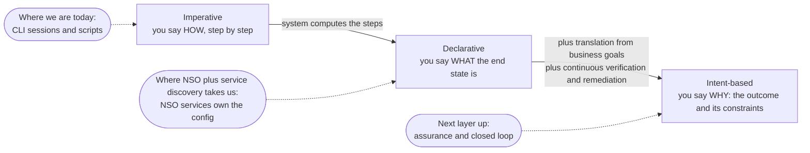
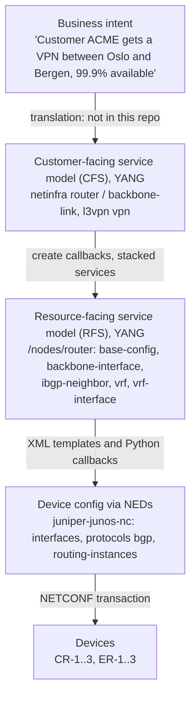
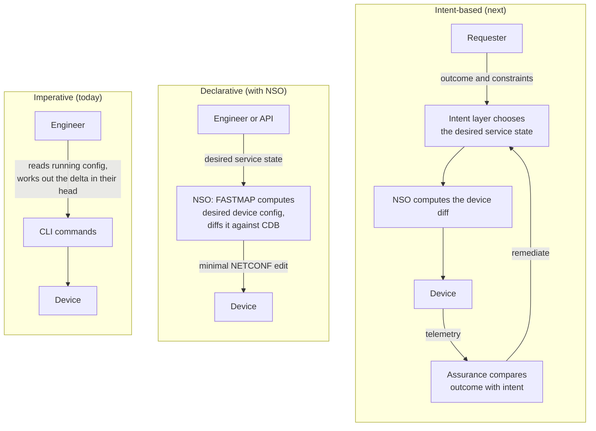
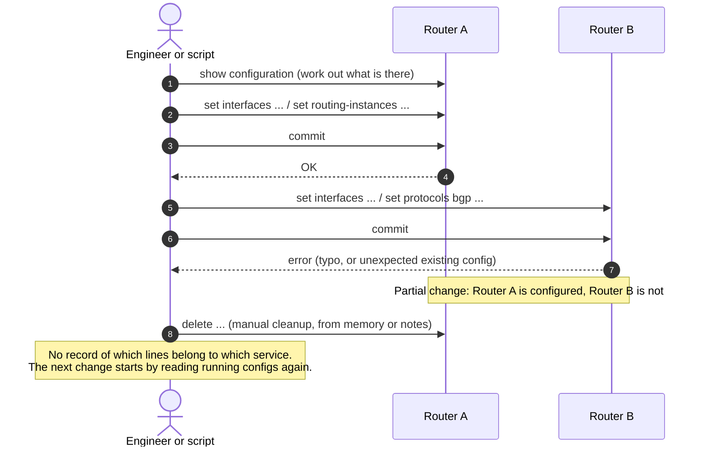
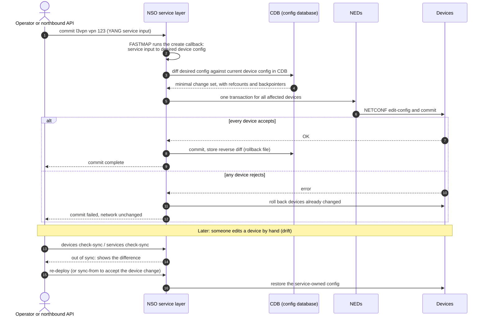
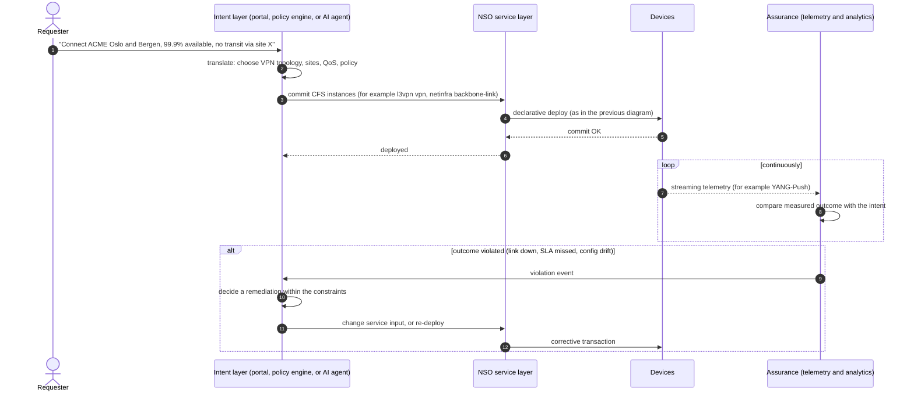
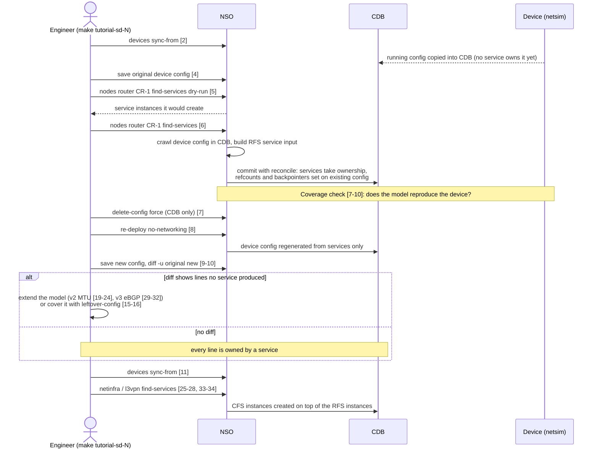

# Provisioning models: imperative, declarative, intent-based

This page explains three ways of provisioning a network and where this
repository, Cisco NSO, and service discovery fit among them. It is written
for network engineers who configure routers today with CLI sessions and
scripts and want to know what changes when NSO owns the services.

Related pages:

- [Architecture overview](architecture.md)
- [Package reference](package-reference.md)
- [End-to-end walkthrough](walkthrough.md)
- [Limitations and assumptions](limitations.md)

## One spectrum, not three boxes

The three models are points on one axis. Each step to the right moves more
of the "how" from the engineer to the system:

Declarative is not an alternative to intent-based. It is the foundation that
intent-based provisioning builds on:

> intent-based = declarative desired state
> + translation from business goals into that state
> + continuous verification that the network still matches, with remediation when it does not

Throughout this page, **Today** marks the team's current CLI and script
workflow, and **With NSO** marks where NSO plus service discovery takes it.

## Why this matters for brownfield

The installed base was built imperatively. Every router's configuration is
the sum of years of CLI sessions, scripts, and one-off fixes. No system holds
a record of *why* each line is there, or which customer or design element it
belongs to.

- **Today:** the device configuration *is* the source of truth. To know what
  a service looks like, an engineer reads running configs.
- **With NSO:** service discovery turns that configuration into declarative
  NSO service instances. NSO then knows which service owns each line of
  device config, and can recompute, compare, and roll back that config.
- **Next:** once services are declarative, an intent layer can sit on top,
  because there is now a model to translate business goals into and a
  desired state to verify against.

You cannot jump straight from imperative to intent-based. An intent layer
needs a declarative model of the network underneath it, and in brownfield,
service discovery is how you get that model without rebuilding the network.

## The three models in plain words

| Model | One-line definition | Analogy | Who owns the "how" |
| --- | --- | --- | --- |
| Imperative | You issue the exact commands, in order, on each device. | Giving a driver turn-by-turn directions: "left at the church, second right, straight for 2 km". | The engineer or the script author. |
| Declarative | You describe the desired end state; the system works out the commands to get there from wherever it is now. | Typing an address into a GPS. It works out the route, and re-routes if you miss a turn. | The system (NSO), using models and templates that engineers wrote once. |
| Intent-based | You state an outcome and its constraints; the system picks the desired state, applies it, and keeps checking that the outcome still holds. | "Get me to the airport by 9, avoid tolls." The navigator chooses the destination terminal and route, and changes plan when traffic changes. | The system, including deciding the desired state and reacting to change. |

**Today:** the team gives turn-by-turn directions. A script is a recorded set
of directions: it works only if the car starts from the place the script
author expected.

**With NSO:** the team gives addresses. A service instance such as
`/l3vpn/vpn{123}` says what VPN 123 should look like, and NSO works out the
device changes from the current state.

## Drawings

### The layer stack

Each layer is expressed in the vocabulary of the layer above it, and is
translated into the vocabulary of the layer below.

- **Today:** engineers work at the bottom two layers only. The upper layers
  exist only in people's heads and in design documents.
- **With NSO:** the CFS, RFS and NED layers exist as code in this repo and
  in NSO. The business-intent layer is still missing; see
  [Where NSO and this repository sit](#where-nso-and-this-repository-sit).

### Who computes the diff

The central difference between the models is *who works out what has to
change*.

## Sequence flows

### Imperative: CLI and scripts (today)

What goes wrong at this end of the spectrum:

- There is no transaction across devices, so failures leave partial state.
- Scripts assume a starting state. If someone changed the device by hand,
  the script either fails or makes things worse.
- Removal is the hard part. Nobody knows which lines are safe to delete.

### Declarative: NSO services (with NSO)

What changes for the engineer:

- You describe the service. NSO computes the change from whatever the
  current state is, so the same input always produces the same result
  (idempotency).
- Changes are transactional across devices, and every commit has a rollback.
- Deleting a service removes exactly the config it created, unless another
  service also uses that config (refcount).
- Drift is detectable (`check-sync`), and repairable (`re-deploy`).

Declarative does not mean NSO acts on its own. In this repo, nothing runs
`check-sync` or `re-deploy` automatically. An operator or a scheduler has to
trigger them. That is the gap the intent-based layer closes.

### Intent-based: translation plus closed loop (next)

The loop is what makes it intent-based. Translation alone is a convenient
front end for a declarative system. Assurance and remediation without
translation is monitoring. Intent-based needs both, on top of a declarative
service layer.

### Brownfield discovery: from imperative config to declarative ownership

This is what the tutorial does. The numbers in brackets are the
[tutorial steps](walkthrough.md#tutorial-step-map) for router CR-1 and the
CFS layers.

- **Reconcile** is the hand-over moment. The config already exists in CDB
  and on the device. Reconcile tells NSO "this service created it", so NSO
  records ownership (backpointers from the device config to the service, and
  refcounts where several services share a line) without pushing anything.
- **Leftover config** (`patches/leftover-config`, the CR-2 class-of-service
  config) is config that is real and needed but not worth modelling as a
  proper service. Giving it a catch-all owner still makes it declarative:
  NSO knows it is intended, and `check-sync` reports drift on it.
- **Compliance** is the ongoing version of the coverage check: compare
  devices against what the services say they should be.

**Caveat in this repo:** the find-services actions commit with reconcile but
without `no-networking`, so if the generated config differs from the device,
NSO pushes the difference. See
[Limitations: discovery is not fully read-safe](limitations.md).

## Comparison

| | Imperative (today) | Declarative (with NSO) | Intent-based (next) |
| --- | --- | --- | --- |
| Source of truth | The running config on each device | Service instances in NSO; device config is derived from them | The intent statement; services and device config are derived from it |
| Idempotency | Only if each script is written to check first | Built in: the same input always produces the same device config | Built in, inherited from the declarative layer |
| Drift handling | Found by accident, or by diffing configs by hand | Detected on demand (`check-sync`), fixed by `re-deploy` or accepted by `sync-from` | Detected continuously by assurance, fixed automatically within policy |
| Rollback | Manual: undo commands from notes or memory | Automatic per transaction; rollback files for every commit | Inherited, plus rollback of the intent itself |
| Change visibility | Whatever the engineer logged | `commit dry-run` shows the exact device diff before commit; commit history per service | Shows the effect on the outcome, not only on config |
| Skills needed | Vendor CLI, scripting | YANG, templates, Python, NSO service design | All of the declarative skills plus policy, telemetry and analytics |
| Typical failure modes | Partial changes, typos, scripts that assume the wrong starting state, config nobody dares remove | Service model does not cover reality (leftover config), wrong mapping logic, out-of-band changes overwritten by `re-deploy` | Wrong translation (correct config for the wrong goal), noisy telemetry triggering flapping remediation, unclear responsibility when the loop acts |
| Fit for brownfield | Native: it is how the brownfield was built | Needs service discovery first; this repo is that step | Needs the declarative layer first; not reachable directly from imperative config |

## Where NSO and this repository sit

NSO is a **declarative** system at its core. Services are YANG models; the
create callback (FASTMAP) maps service input to device config; NSO computes
diffs, runs transactions, and tracks ownership. NSO releases from 6.5 to 6.7
add features that move it toward the intent end, mostly around drift and
out-of-band changes:

| Release | Feature | Why it is intent-like |
| --- | --- | --- |
| 6.5 | Out-of-band policies; `commit confirm-network-state` | NSO decides what to do when device config changed outside NSO, instead of an engineer deciding each time. |
| 6.6 | Partial reconcile (`re-deploy reconcile` with include/exclude); `check-sync with-service-meta-data` | Finer control over ownership hand-over, and verification that ownership was really transferred. |
| 6.7 | `abort` and `default-action` rules for out-of-band policies; dry-run drift detection; southbound YANG-Push subscriptions; Adaptive MCP server | Building blocks for verification (drift detection, telemetry) and for an AI-driven translation front end (MCP). |

None of these features is a full intent layer on its own. NSO provides the
declarative service layer and some verification hooks. Translation from
business goals and closed-loop remediation need something on top, such as a
portal or policy engine, an assurance product, or an AI agent working
through the MCP server under NACM. The feature list is based on the Cisco
NSO "What's New" pages for 6.5, 6.6 and 6.7. It has not been tested in this
repository, which targets NSO 6.6 and later.

Where the packages in this repo sit in the layer stack:

| Package | Layer | Position on the spectrum |
| --- | --- | --- |
| `netinfra` (`/netinfra/router`, `/netinfra/backbone-link`, internal `ibgp-fullmesh`) | CFS | Closest to intent. Input is design-level (a router, a link between two routers); IDs and addresses can be allocated by Resource Manager instead of being given. |
| `respl3vpn` (`/l3vpn/vpn`, v3 `vrf-ebgp-customer`) | CFS | Close to intent. Input is a VPN and its endpoints, not VRF config lines. |
| `netinfra-rfs` (`/nodes/router{X}`: base-config, backbone-interface, ibgp-neighbor, vrf, vrf-interface, v3 ebgp-neighbor) | RFS | Declarative, device-facing. Input still mirrors device config (interface names, addresses, VRF targets). |
| `leftover-config` | RFS catch-all | Declarative ownership with no abstraction: it holds the config as-is. |
| `multi-service-action` | Tooling | Operational helper: `check-sync` and `re-deploy` across every service on a node. It is the manual trigger for the verification step that an intent loop would run automatically. |

See the [package reference](package-reference.md) for details of each
package.

## Common misconceptions

- **"Declarative means no code."** Wrong. The contract is declarative (you
  give desired state, NSO computes the diff), but the mapping inside a
  create callback is ordinary Python, written step by step. In this repo,
  `router.py`, `l3vpn.py` and `nodes_router.py` are imperative logic that
  produces a declarative result. FASTMAP is what makes that safe: the
  callback only ever describes the full desired state, and NSO works out the
  change.
- **"Intent-based is a product you buy."** Wrong. It is a layer and a loop:
  translation on top of a declarative model, and continuous verification
  with remediation. Products provide parts of it, and none of them work
  without a declarative service model of your network underneath.
- **"Declarative means the network repairs itself."** Wrong. NSO knows the
  desired state, but it only compares and repairs when something triggers
  `check-sync` or `re-deploy`. Automatic repair is the intent loop.
- **"Discovery is read-only."** Not in this repo as written: `find-services`
  can push config (see the caveat above). In general, discovery should run
  with `no-networking` or as a dry-run until its output has been reviewed.
- **"Once services are discovered, we are done."** Discovery transfers
  ownership of today's config. Out-of-band changes, new service variants,
  and leftover config keep arriving, so the coverage check becomes an
  ongoing compliance task.

## Glossary

| Term | Meaning |
| --- | --- |
| CDB | NSO's configuration database. Holds service instances and NSO's copy of every device's config. |
| CFS | Customer-facing service: a service model expressed in design or business terms (in this repo, `netinfra` and `l3vpn`). Usually built by stacking RFS instances. |
| RFS | Resource-facing service: a service model close to device config (in this repo, the `/nodes/router` services). |
| FASTMAP | NSO's mechanism for service create: the create callback describes the full desired config for a service, and NSO computes the diff against the current state, including what to remove on update or delete. |
| Backpointer | A reference stored on a device config node pointing to the service(s) that created it. |
| Refcount | A count on a device config node of how many services created it. The node is removed only when the last owning service is deleted. |
| Reconcile | Telling NSO that existing device config was created by a service, so ownership (backpointers and refcounts) is recorded without changing the device. `keep-non-service-config` and `discard-non-service-config` decide what happens to config that the service does not produce. |
| Out-of-band | A change made on a device outside NSO, for example by CLI. Step 29 of the tutorial simulates one. |
| Drift | A difference between what NSO thinks a device holds and what it actually holds, usually caused by out-of-band changes. |
| Coverage check | This tutorial's loop for testing a service model against a device: find-services, delete device config in CDB, re-deploy with no-networking, diff against the original. |
| Leftover config | Config that is needed but not modelled as a real service; given a catch-all owner so that it is still tracked. |
| Closed loop | Measure, compare with intent, act, and repeat, without a human starting each step. |
| YANG-Push | A standard (RFC 8641) for devices to stream YANG-modelled data to subscribers; a common telemetry source for assurance. |
